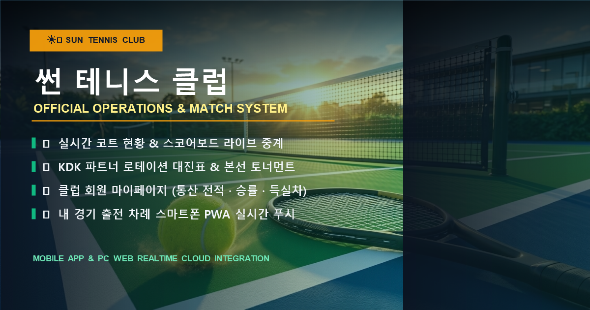

# ☀️ 썬 테니스 클럽 (SUN TENNIS CLUB)

> **태양처럼 뜨거운 열정과 페어플레이!**  
> 썬(SUN) 테니스 클럽 월례회 및 대회 공식 운영 웹/앱 시스템



---

## 🎾 주요 기능 및 아키텍처

### 1. ☀️ 썬 클럽 브랜드 아이덴티티
- **브랜드 비주얼**: 황금빛 태양(Rising Sun)과 네온 볼트 테니스 볼이 조화된 썬 클럽 공식 엠블럼.
- **감각적인 테마**: 윔블던 에메랄드 그린 + 호주오픈 하드 코트 블루 + 골드 앰버의 다크 슬레이트 글래스모피즘 UI.
- **반응형 듀얼 레이아웃**:
  - **PC 데스크톱**: 웅장한 히어로 배너, 코트 가동 상태 실시간 요약 패널, 모바일 프레임이 어우러진 넓고 세련된 웹 대시보드.
  - **스마트폰**: 실제 네이티브 앱 같은 풀스크린 UX, 하단 플로팅 탭 네비게이션.

### 2. 🎾 실시간 코트 현황 & 스코어보드 라이브 (`TennisCourtBoard`)
- Supabase Realtime 기반 코트별(1~4번 코트) 실시간 스코어(Game Score) 동기화.
- 경기 중(Playing) / 대기 중(Waiting) 상태 자동 표시 및 원클릭 스코어 조절 다이얼로그.
- 코트 배정 및 점수 업데이트 시 해당 선수 스마트폰으로 자동 Web Push 알림 트리거.

### 3. 📊 스마트 대진표 생성기 (`TournamentScheduleView`)
- 참가자 명단(쉼표 구분) 입력 후 **🏓 실시간 대진표 자동 생성** 원클릭 지원.
- 몬테카를로 실력 밸런싱 KDK 파트너 순환 복식 대진 알고리즘 (`lib/kdk.ts`).
- $2^n$ 본선 토너먼트 규격 및 상위 시드 부전승(BYE) 자동 배치 브래킷 (`lib/tournament.ts`).

### 4. 👤 마이페이지 & VIP 멤버십 전적 관리 (`MyPage`)
- 썬 클럽 VIP 멤버십 프로필 배너 (금배/은배/동배/국화/개나리/테린이 등급 표시).
- 통산 전적 카드: 총 경기, 승, 패, 승률(%), 총 득실차.
- 최근 경기 이력 타임라인.

### 5. 👑 운영자 회원 관리 센터 (`AdminUserManagement`)
- 전체 회원 목록 조회, 실력 등급 및 운영자(Admin) 권한 실시간 변경.

### 6. 📱 PWA (Progressive Web App) & Web Push
- 스마트폰 브라우저에서 '홈 화면에 추가' 시 독립 앱(Standalone)으로 실행.
- VAPID 표준 기반 웹 푸시 알림: 코트 배정 및 출전 순서 시 스마트폰 상단 팝업 알림.
- Open Graph (OG) 소셜 공유 메타태그 완벽 지원.

---

## 🚀 빠른 시작

```bash
# 1. 의존성 설치
npm install

# 2. 로컬 개발 서버 실행
npm run dev
```

브라우저에서 [http://localhost:3000](http://localhost:3000)으로 접속하시면 실시간 썬 테니스 클럽 앱을 확인하실 수 있습니다.
*(서버 없이 브라우저에서 바로 열어보시려면 `index.html` 파일을 더블클릭하셔도 완벽하게 동작합니다!)*
